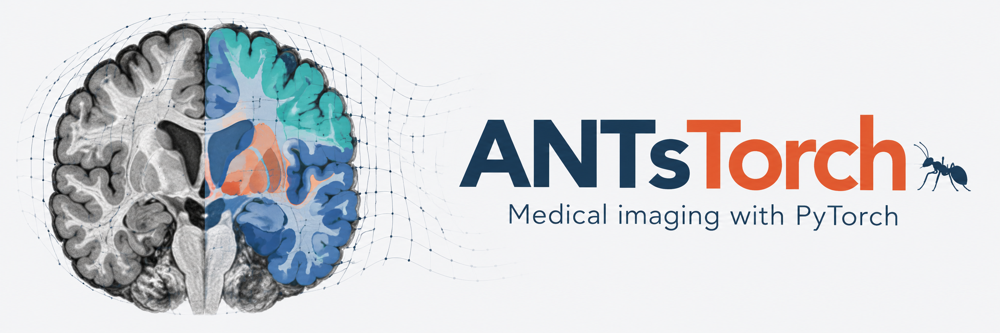

<div align="center">



<!-- AI-generated conceptual artwork; not an ANTsTorch inference result. -->

# ANTsTorch

### Medical imaging with PyTorch, powered by ANTsX

Deep learning architectures · Pretrained applications · Differentiable image processing · Registration

[](pyproject.toml)
[](https://pytorch.org/)
[](LICENSE)
[](https://pypi.org/project/antstorch/)
[](https://pubmed.ncbi.nlm.nih.gov/33907199/)

[Documentation](docs/index.md) · [Examples](examples/README.md) · [API guide](docs/api.md) · [Benchmarks](tools/benchmarks/README.md) · [Model validation](docs/model_validation.md)

</div>

---

**ANTsTorch brings the ANTsX medical imaging ecosystem to PyTorch.** Build and train 2-D and 3-D networks, apply pretrained models to ANTs images, and explore tensor-based bias correction, registration, cortical thickness estimation, and normalizing flows.

It complements [ANTsPyNet](https://github.com/ANTsX/ANTsPyNet/) and [ANTsRNet](https://github.com/ANTsX/ANTsRNet/), with ports of ANTsPyNet architectures and pretrained applications. Porting and numerical validation are ongoing; see the [validation guide](docs/model_validation.md) for the scope of available comparison evidence.

## What you can do

| Area | Capabilities | Start here |
| --- | --- | --- |
| **Deep learning** | 2-D and 3-D U-Nets, ResNets, dense networks, deep back-projection networks, and task-specific architectures | [U-Net example](examples/unet_2d.py) |
| **Pretrained applications** | Brain extraction, tissue segmentation, anatomical labeling, lung imaging, super-resolution, and more | [Application catalog](#pretrained-applications) |
| **Image processing** | Preprocessing, augmentation, and tensor-native N4 bias field correction | [N4 example](examples/n4_synthetic.py) |
| **Registration** | SyN, affine, and B-spline stationary velocity field registration | [SyN tutorial](docs/antsx_tutorial_syn.md) · [B-spline tutorial](docs/antsx_tutorial_bspline_flows.md) |
| **Cortical thickness** | Segmentation-driven workflows and a tensor implementation of DiReCT | [Implementation guide](antstorch/direct/README.md) |
| **Normalizing flows** | Flow architectures and LAMNR hybrid training workflows | [Training guide](docs/lamnr_hybrid_trainer.md) |

## Installation

Requires **Python 3.10+** and **Git**. From a terminal:

```bash
git clone https://github.com/ANTsX/ANTsTorch.git
cd ANTsTorch
python3 -m venv .venv
source .venv/bin/activate
python -m pip install --upgrade pip
python -m pip install -e .
```

On Windows, activate the environment with `.venv\Scripts\activate`.

For a direct installation without a working checkout:

```bash
python -m pip install git+https://github.com/ANTsX/ANTsTorch.git
```

Installation includes ANTsPy, PyTorch, JAX, and other scientific dependencies. Git is needed for the `antsnormflows` dependency. See the [installation guide](docs/installation.md) for device selection, downloads, and caching.

## Quick start

### Build a 2-D U-Net

Run a forward pass with synthetic input; no image or model downloads are needed.

```python
import torch
import antstorch

model = antstorch.create_unet_model_2d(
    input_channel_size=1,
    number_of_outputs=3,
    number_of_filters=(8, 16, 32),
    mode="classification",
).eval()

image = torch.rand(1, 1, 64, 64)  # batch, channels, height, width
with torch.inference_mode():
    probabilities = model(image)

print(tuple(probabilities.shape))  # (1, 3, 64, 64)
```

This network has random weights. Train it before using its predictions for segmentation.

### Extract a brain from a T1 MRI

Use a local scalar 3-D T1 image with a pretrained model:

```python
import ants
import antstorch

image = ants.image_read("t1.nii.gz").clone("float")
probability = antstorch.brain_extraction(image, modality="t1", device="cpu")
mask = ants.threshold_image(probability, 0.5, 1.0, 1, 0)
ants.image_write(image * mask, "t1_brain.nii.gz")
```

Weights and templates download on first use and are cached under `~/.antstorch`. This example thresholds the probability map at 0.5; inspect the result for your data. Other extraction modalities may return different output structures.

### Run the examples

From the repository root after installation:

```bash
# Synthetic examples: no data or pretrained-weight downloads
python examples/unet_2d.py
python examples/n4_synthetic.py

# Registration: downloads ANTsPy sample images
python examples/syn_registration.py --output-dir example_outputs/syn

# Brain extraction: provide your own T1 MRI
python examples/brain_extraction.py /path/to/t1.nii.gz --output-dir example_outputs/brain
```

Registration and brain extraction examples default to CPU and accept `--device` and `--output-dir`. Matching output files are overwritten. See the [example guide](docs/examples/index.md) for outputs and limitations, and the [installation guide](docs/installation.md#devices-and-data) for device constraints.

## Pretrained applications

The application layer provides ports using ANTsPyNet pretrained weights. Available workflows include:

| Domain | Applications |
| --- | --- |
| **Brain extraction** | T1, T2, T2*, FA, FLAIR, MRA; T1 three-tissue, hemisphere, and lobe variants |
| **Brain anatomy** | Deep Atropos tissue segmentation, Desikan–Killiany–Tourville and Harvard–Oxford labeling, Deep FLASH, cerebellar morphology, cortical thickness |
| **Small structures** | HippMapp3r and two-stage hippocampus segmentation, hypothalamus and subunits, claustrum |
| **White matter lesions** | SYSU-Media, HyperMapp3r, ANTsXNet WMH, and SHIVA PVS/WMH ensembles |
| **Lung imaging** | Extraction in proton MRI, CT, ventilation MRI, and X-ray; lobe, airway, vessel, and pulmonary artery segmentation |
| **Mouse imaging & histology** | Brain extraction, parcellation, cortical thickness, histology masks, and histology super-resolution |
| **Image quality & enhancement** | MRI modality classification, neural image quality assessment, MRI super-resolution, and anisotropic 2×–6× super-resolution |

Availability does not imply numerical parity for every modality or model variant. The [model validation guide](docs/model_validation.md) explains the comparison harness, saved evidence, and remaining gaps.

## Benchmarks

The **[benchmark guide](tools/benchmarks/README.md)** brings together comparison protocols, recorded results, figures, and instructions for reproducing the runs.

| Suite | Comparisons | Measures |
| --- | --- | --- |
| **[Registration](tools/benchmarks/README.md#registration)** | ANTsTorch, syntx, FireANTs, and an ANTs C++ baseline on Mindboggle-101; the reported run covers 30 of the 90 defined pairs | DKT31 label overlap (Dice), deformable registration time, Jacobian statistics, and folding percentage |
| **[Image-processing primitives](tools/benchmarks/README.md#primitive-comparisons-n4-denoising-cortical-thickness-b-spline-fitting)** | ANTs and ANTsTorch implementations of N4 bias correction, denoising, cortical thickness, and B-spline fitting | Run time and numerical agreement, with recorded MPS and CUDA results |

Registration comparisons use a shared affine initialization in the default fair mode. Read the results alongside their hardware, model settings, and inverse-transform conventions; CPU and GPU timings describe different execution environments. The guide includes the data requirements and commands needed to reproduce each comparison.

## Learn more

- **[Documentation](docs/index.md)** — installation, examples, API conventions, and tutorials.
- **[API guide](docs/api.md)** — entry points, tensor layouts, image geometry, and transform conventions.
- **[SyN registration](docs/antsx_tutorial_syn.md)** — registration workflows and transform handling.
- **[N4 & B-spline registration](docs/antsx_tutorial_bspline_flows.md)** — tensor-based processing and physical image domains.
- **[LAMNR hybrid training](docs/lamnr_hybrid_trainer.md)** — normalizing-flow training workflows.
- **[Development tools](tools/README.md)** — application checks, benchmarks, and supporting utilities.
- **[Documentation publishing](docs/publishing.md)** — build the documentation and publish on Read the Docs.
- **[ANTsX tutorial examples](https://gist.github.com/ntustison/12a656a5fc2f6f9c4494c88dc09c5621#antsxnet)** — additional self-contained workflows.

## Research, community & license

For background and applications, see the [ANTsX ecosystem publication](https://pubmed.ncbi.nlm.nih.gov/33907199/).

Questions, bug reports, and contributions are welcome through [GitHub Issues](https://github.com/ANTsX/ANTsTorch/issues) and pull requests. Please include a minimal example and relevant package versions when reporting a problem.

ANTsTorch is released under the [Apache License 2.0](LICENSE).

We gratefully acknowledge grant support from the **Office of Naval Research (N0014-23-1-2317)**.
