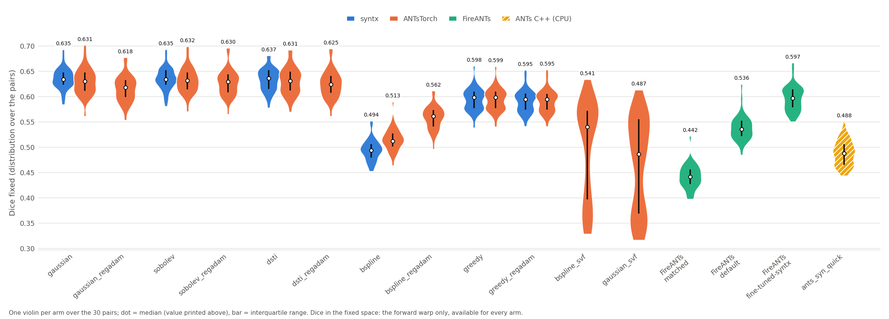
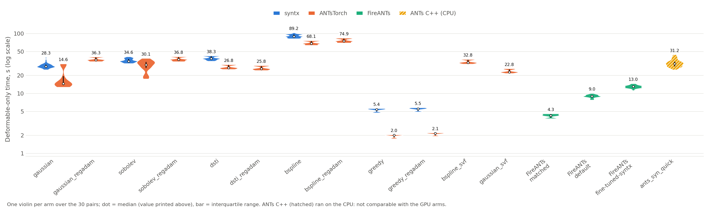
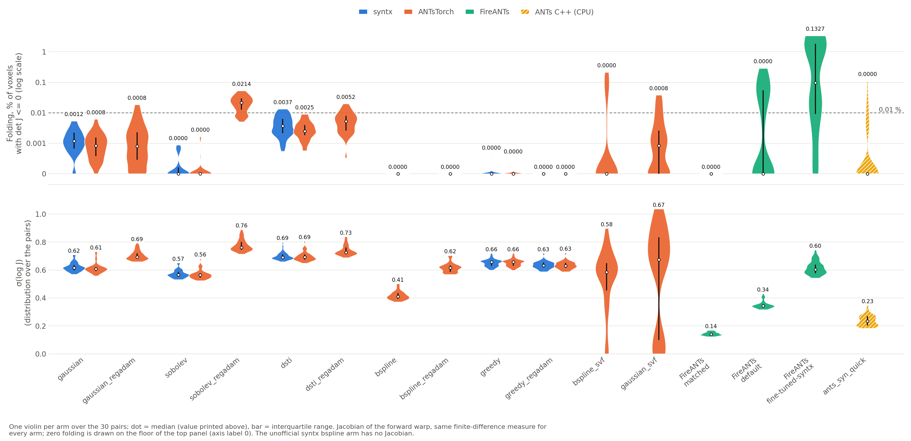

# Benchmarks

- **[Registration](#registration)** using [Mindboggle-101](frontiersin.org/Brain_Imaging_Methods/10.3389/fnins.2012.00171/full) data
    * [syntx](https://github.com/stnava/syntx)
    * [ANTsTorch](https://github.com/ANTsX/ANTsTorch) 
    * [FireANTs](https://github.com/rohitrango/fireants) 

- **[Primitives](#primitive-comparisons-n4-denoising-cortical-thickness-b-spline-fitting)** — ANTs vs ANTsTorch
    * N4 bias-field correction
    * denoising
    * cortical thickness (KellyKapowski)
    * B-spline scattered-data approximation
    

## Registration

1. [Overview](#overview)
    * [Models](#models)
    * [Optimizers](#optimizers)
2. [FireANTs](#fireants)
3. [The Mindboggle benchmark](#the-mindboggle-benchmark)
4. [Results](#results)
5. [Reproducing the runs](#reproducing-the-runs)


### Overview

Most of ANTsTorch's registration code follows [syntx](https://github.com/stnava/syntx).  ANTsTorch also includes a stationary velocity flow (SVF) framework.

- **The dense SyN formulation:** symmetric, midpoint-based, Eulerian fields, local cross-correlation (`cc2`), 4-2-1 pyramid, and the fluid regularizers (Gaussian, Sobolev, DST-I).
- **`greedy`:** the one-directional compositive model of `syntx.greedy`, including syntx's millimetre-isotropic deformable pyramid (`antstorch.greedy`, bit-identical to syntx on CPU).
- **The benchmark protocol:** the 90 Mindboggle pairs, N4 pre-processing, the DKT31 Dice measures, and the
  model names (`gaussian`, `sobolev`, `dsti`, ...).
- **The syntx default hyper-parameters** (`syntx_defaults=True`), selected per regularizer and optimizer.

<!-- Where ANTsTorch differs, it is by implementation (PyTorch-native sampling through`antstorch._torch_compat`, autograd or analytical gradients, MPS/CPU/CUDA support, the `antstorch.syn` / `antstorch.greedy` / `antstorch.bspline_flows` modules) and not by algorithm; the parity tests live in `tests/greedy` and the benchmark scripts of this directory. -->

### Models

| Family | ANTsTorch entry point | Model names | Inverse |
|---|---|---|---|
| Dense SyN | `antstorch.syn.syn_registration` | `gaussian_syn`, `sobolev_syn`, `dsti_syn`, `bspline_syn` | yes (symmetric) |
| Greedy (compositive) | `antstorch.greedy.greedy_registration` (alias `greedy`) | `greedy`, `greedy_regadam` | no (optional Anderson inverse with `return_inverse=True`) |
| Stationary velocity field (SVF) | `antstorch.bspline_flows.bspline_svf_registration`, `gaussian_svf_registration` | `bspline_svf` (alias `svf`), `gaussian_svf` | yes (by integration) |
| ANTs baselines | `ants.registration` | `ants_syn_quick`, any deformable-only `type_of_transform` | — |

- **Dense SyN** differs between variants only by the regularizer applied to the update field.
- **Greedy** estimates one forward displacement field and has no native inverse; its `dice_moving` and `dice_sym` depend on a post-hoc inverse, so `dice_fixed` is its primary measure.
- **SVF** parameterizes a velocity field (B-spline or dense Gaussian-smoothed) and exponentiates it.

### Optimizers

| Optimizer | Where | What it does |
|---|---|---|
| `gradient_descent` | `syn_registration` default | CFL-scaled step along the regularized gradient |
| `reg_adam` | `syn_registration`, `greedy` (name `regadam`) | `greedy.py` Adam: bias-corrected moments, the Adam quotient is smoothed (`regadam_sigma` 0.8); moments reset at each level |
| `syn_reg_adam` | `syn_registration` (sobolev, dsti only) | `syntx.syn()` variant: gradient regularized, Adam quotient, Green operator applied again, CFL step shared by both half-warps; used by the `dsti` fair-mode arm |

### [FireANTs](https://github.com/rohitrango/FireANTs)

GPU-accelerated multi-scale diffeomorphic registration that replaces plain gradient descent with adaptive (Adam-type) Riemannian optimization.  [Jena et al., *Nature Communications*, 2024](https://www.nature.com/articles/s41467-026-72508-3).
 

[Syntx's evaluation of FireANTs on Mindboggle](https://github.com/stnava/syntx/blob/main/docs/v_fire_ants/README.md). Main points: 
* FireANTs' default SyN plateaus near 0.39 DKT Dice,
* Greedy setting reaches about 0.62–0.63 at roughly 3.5x the speed, but 3.7–15.6 % folded voxels (vs 0.0005 % for `syntx.syn`), no reliable inverse. 

    

### The Mindboggle benchmark

[Mindboggle-101](https://mindboggle.info/data.html) (Klein & Tourville 2012, *Front. Neurosci.* 6:171): manually labeled T1-weighted brains with DKT31 cortical labels (`labels.DKT31.manual.nii.gz`), from the cohorts OASIS-TRT-20, NKI-RS-22, NKI-TRT-20 and MMRR-21.

- **Pairs:** 90 pairs (40 intra-subject and 50 inter-subject), defined in `antstorch/benchmark/pairs.csv`.
- **Pre-processing:** brain-extracted volumes, N4 bias correction (cached), images normalized as in syntx.
- **Location:** `ANTSTORCH_MINDBOGGLE_DATA_DIR` (default `~/data/mindboggle/volumes`; the script uses
  `DATA_DIR`). Directory layout: `antstorch/benchmark/data.py`.

<details>
<summary>General options of the benchmark script.</summary>

By default the script runs in the *fair mode*: syntx runs first and produces the affine of each pair, ANTsTorch starts from the same affine file and runs syntx's loop (per-iteration inverses with 10 steps, syntx parity, autograd; `dsti` with `syntx.syn()`'s `reg_adam`), and the times compared are deformable-only.

| Option | Default | Meaning |
|---|---|---|
| `--pairs N [N ...]` | `0 24 88` | Pair indices (0-89; 0-39 intra-subject, 40-89 inter-subject). Use `$(seq 0 3 89)` for 30 pairs, `$(seq 0 89)` for all. |
| `--models M [M ...]` | `gaussian sobolev dsti` | Models to run: `gaussian`, `sobolev`, `dsti`, `bspline`, their `_regadam` variants, `greedy`, `greedy_regadam`, `bspline_svf`, `gaussian_svf`. The default models are those with a syntx counterpart of the same algorithm. The SVF models have none: ANTsTorch only, from the shared affine, scored with the same Dice, time and Jacobian measures; they run after the others. |
| `--device` | auto-detect | `cuda`, `mps` or `cpu` (cuda, then mps, then cpu), passed identically to both libraries. |
| `--out-dir` | `~/Desktop/syntx_antstorch_mindboggle_comparison` | Output directory (JSON, Markdown summary, cached affines). Reuse the same directory for `--fireants-only`, `--fireants-sweep` and `--ants-only`, which read the syntx affines cached there. |
| `--tmp-dir` | `<out-dir>/_scratch` | Base of the per-run scratch folders. syntx and several ANTsTorch paths write displacement fields to the system temp directory and never delete them; each run now gets its own folder, deleted after scoring. Put it on a disk, not on a tmpfs. |
| `--keep-fields` | off | Keep the scratch folders and the per-pair displacement fields (greedy, FireANTs). Needs hundreds of MB per run, so a lot of disk on 90 pairs. Records then lack `_fields_deleted`. |
| `--no-warmup` | off | Skip the throwaway first run per library (device and kernel initialisation), which is otherwise excluded from the timings. |
| `--skip-syntx` | off | Run only the ANTsTorch arms (the summary shows "—" for syntx). For ANTsTorch-only ablations, where the syntx arms would repeat an earlier run. The shared affine is then not syntx's. |
| `--own-defaults` | off | Disable the fair mode: ANTsTorch runs with its own defaults (end-of-level inverses, analytical gradients, no syntx parity) and fits its own affine. |
| `--legacy-defaults` | off | ANTsTorch only: restore its previous defaults (`lncc`, `grad_step` 0.5, `flow_sigma` 3.0, 100/100/50 iterations, physical sigma, per-iteration inverses) instead of the syntx-aligned ones (`syn_registration(syntx_defaults=False)`). Writes to an `_legacy` output directory. |
| `--syntx-parity` | off | ANTsTorch only: mimic syntx's loop (CFL step scaled by √(current/original size), early stop on loss slope ≤ 1e-6 over 10 iterations, restore of the best-loss warps). |
| `--no-analytical-gradients` | off | ANTsTorch only: autograd through the image interpolation, as syntx's benchmark does (`use_analytical_gradients=False`), instead of the analytical image-gradient backward. |
| `--inverse-schedule {per_iteration,end_of_level}` | ANTsTorch's own | ANTsTorch only: when the half-warp inverses are maintained. `end_of_level` inverts once after the last level; validate the Dice against a `per_iteration` run first. |
| `--end-of-level-inverse-steps N` | 30 | Solver steps of the single end-of-level inversion. |
| `--inverse-method {anderson,fixed_point,hybrid_lm}` | `anderson` | ANTsTorch only: in-loop field-inversion solver. `fixed_point` was about 2.2 times faster than `anderson` on MPS at 6 steps; syntx keeps its own solver, so use this as an ablation, not as the main comparison. |

Options for the ANTs C++ baseline (`--ants-only`):

| Option | Default | Meaning |
|---|---|---|
| `--ants-only` | off | Run only the ANTs C++ baseline (antspyx, CPU) on `--pairs`, from the syntx affines cached in `--out-dir`. Writes `ants_<model>_results.json` and `ants_<model>_summary.md`; leaves `comparison_results.json` untouched. Cannot be combined with the FireANTs options. |
| `--ants-model` | `ants_syn_quick` | `antsRegistrationSyNQuick[so]`, or any deformable-only `ants.registration` `type_of_transform` (e.g. `SyNOnly`). |
| `--ants-threads N` | environment | Sets `ITK_GLOBAL_DEFAULT_NUMBER_OF_THREADS` before ANTs is loaded. The time of ANTs depends on it: keep it fixed and report it. |

</details>

<details>
<summary>FireANTs options of the benchmark script.</summary>

All options need `--fireants` (or imply it) and a CUDA GPU. FireANTs enters once per pair, after syntx, from the shared syntx affine, on the same auto-normalised images; times are deformable-only and synchronised.

| Option | Meaning |
|---|---|
| `--fireants` | Add FireANTs (`GreedyRegistration`) as a third arm next to syntx and ANTsTorch. |
| `--fireants-only` | Run only FireANTs (implies `--fireants`) on `--pairs`. It reads the syntx affines cached in `--out-dir` by an earlier run, so use the same `--out-dir`. Writes `fireants_<preset>_results.json` and `fireants_<preset>_summary.md`, leaves `comparison_results.json` untouched, and, if that file exists, compares FireANTs with the syntx and ANTsTorch arms of the same pairs. |
| `--fireants-sweep` | FireANTs-only hyper-parameter sweep (implies `--fireants`; same cached affines). Writes `fireants_sweep.md` and `fireants_sweep.json`. |
| `--sweep-set {1,2,3}` | Grid used by `--fireants-sweep`: 1 = warp smoothing × CC window (plus a few learning rates); 2 = larger learning rates (1, 2, 4) × warp smoothing; 3 = gradient smoothing (1, 2, 3) × warp smoothing (0.25, 0.35, 0.5) at lr 0.4. |
| `--fireants-preset {matched,default,fine-tuned-syntx}` | Complete configuration (pyramid 4-2-1 in all three), see below. Default `matched`. |
| `--fireants-iterations N N N` | Iterations per pyramid level (three values); overrides the preset. `1 1 1` with `--fireants-lr 0` checks the affine export and scoring chain: the Dice should equal the affine-only Dice. |
| `--fireants-lr` | Adam learning rate (`optimizer_lr`). |
| `--fireants-warp-sigma` | `smooth_warp_sigma`: smoothing of the displacement field, in voxels. Lower values give a less regular field and more folding. |
| `--fireants-grad-sigma` | `smooth_grad_sigma`: smoothing of the gradient before the Adam step. |
| `--fireants-cc-kernel` | `cc_kernel_size`: window of the local cross-correlation. |
| `--fireants-early-stop` | Keep FireANTs' own convergence stop (tolerance 1e-6 on the loss slope, 10 iterations). Off by default, so every nominal iteration runs, as for syntx and ANTsTorch (equal budget, comparable times). |
| `--fireants-verbose` | Show FireANTs' own console output (progress bars, warnings), silenced by default. |
| `--no-normalize` | Feed FireANTs the raw images instead of the auto-normalised ones that syntx registers. |

Explicit `--fireants-preset` options:

| Preset | Iterations | Warp σ | Grad σ | lr | CC window | Notes |
|---|---|---|---|---|---|---|
| `matched` (default) | 100 / 100 / 20 | 1.0 | 1.0 | 0.5 | 5 | Same iteration budget as syntx and ANTsTorch. A smaller learning rate tends to underfit FireANTs. |
| `default` | 200 / 100 / 25 | 0.5 | 1.0 | 0.5 | 7 | FireANTs' own defaults with the schedule of its tutorial: what a user gets without tuning. |
| `fine-tuned-syntx` | 100 / 100 / 50 | 0.35 | 2.0 | 0.4 | 5 | The "Tuned Greedy Compositive" setting of syntx's `docs/v_fire_ants` (3.7 % folded voxels reported there). Its last level has 50 iterations, against 20 for the other arms: add `--fireants-iterations 100 100 20` for an equal budget. |

</details> 


#### Evaluation measures

| Measure | Definition |
|---|---|
| `dice_fixed` | Dice in the fixed space  |
| `dice_moving` | Dice in the moving space (if inverse exists) |
| `dice_sym` | mean of the two |
| time | deformable-only in second |
| Jacobian | min, max, mean, and σ(log J). |
| folding % | voxels with det ≤ 0 | 


#### Results
Summarised run: 

* 30 of the 90 pairs (`--pairs $(seq 0 3 89)`)
* 14 intra-subject and 16 inter-subject.
* All 12 models.
* "fair" mode (syntx's affine shared by every arm, mean affine-only Dice 0.343).
* syntx, ANTsTorch, FireANTs, and an ANTs C++ baseline.
* NVIDIA GPU A6000, 48 GB for the first three and CPU w/ 8 threads of a 20-core machine for the latter.

| Model | Library | Dice sym | Dice fixed | Time (s) | folding % (det ≤ 0) | pairs with folding > 0.01 % | max J | σ(log J) |
|---|---|---|---|---|---|---|---|---|
| `gaussian` | syntx | 0.6348 | 0.6360 | 29.1 | 0.0012 | 0 | 30.5 | 0.616 |
| `gaussian` | ANTsTorch | 0.6291 | 0.6303 | 18.3 | 0.0008 | 0 | 27.0 | 0.608 |
| `gaussian_regadam` | ANTsTorch | 0.6157 | 0.6161 | 37.3 | 0.0008 | 2 | 34.9 | 0.692 |
| `sobolev` | syntx | 0.6346 | 0.6356 | 35.5 | 0.0000 | 0 | 25.5 | 0.566 |
| `sobolev` | ANTsTorch | 0.6313 | 0.6323 | 29.4 | 0.0000 | 0 | 21.6 | 0.563 |
| `sobolev_regadam` | ANTsTorch | 0.6289 | 0.6281 | 37.7 | 0.0214 | 23 | 57.3 | 0.761 |
| `dsti` | syntx | 0.6341 | 0.6338 | 38.9 | 0.0037 | 3 | 38.5 | 0.690 |
| `dsti` | ANTsTorch | 0.6315 | 0.6312 | 27.6 | 0.0025 | 0 | 36.1 | 0.692 |
| `dsti_regadam` | ANTsTorch | 0.6263 | 0.6255 | 26.5 | 0.0052 | 5 | 46.9 | 0.726 |
| `bspline` (unofficial syntx arm) | syntx | 0.4957 | 0.4955 | 90.6 | n/a | n/a | n/a | n/a |
| `bspline` | ANTsTorch | 0.5163 | 0.5163 | 69.6 | 0.0000 | 0 | 6.5 | 0.411 |
| `bspline_regadam` | ANTsTorch | 0.5586 | 0.5587 | 76.4 | 0.0000 | 0 | 18.1 | 0.615 |
| `greedy` | syntx | 0.5335 | 0.5946 | 5.3 | 0.0000 | 0 | 13.3 | 0.657 |
| `greedy_regadam` | syntx | 0.5308 | 0.5918 | 5.5 | 0.0000 | 0 | 13.5 | 0.633 |
| `greedy` | ANTsTorch | 0.5335 | 0.5946 | 2.0 | 0.0000 | 0 | 13.7 | 0.657 |
| `greedy_regadam` | ANTsTorch | 0.5307 | 0.5918 | 2.1 | 0.0000 | 0 | 13.6 | 0.631 |
| `bspline_svf` | ANTsTorch | 0.4478 | 0.4970 | 33.8 | 0.0000 | 6 | 19.6 | 0.585 |
| `gaussian_svf` | ANTsTorch | 0.4179 | 0.4672 | 23.6 | 0.0008 | 4 | 30.1 | 0.674 |
| FireANTs `matched` (100 / 100 / 20) | FireANTs | 0.3971 | 0.4424 | 4.3 | 0.0000 | 0 | 1.8 | 0.140 |
| FireANTs `default` (200 / 100 / 25) | FireANTs | 0.4422 | 0.5397 | 9.0 | 0.0000 | 12 | 3.8 | 0.344 |
| FireANTs `fine-tuned-syntx` (100 / 100 / 50) | FireANTs | 0.4608 | 0.5978 | 13.0 | 0.1327 | 22 | 10.0 | 0.603 |
| `ants_syn_quick` (CPU, 8 threads) | ANTs C++ | 0.4889 | 0.4889 | 32.2 | 0.0000 | 3 | 2.9 | 0.233 |

- Only `gaussian`, `sobolev`, `dsti` and `greedy` are like-for-like between syntx and ANTsTorch. The `*_regadam` dense rows (`gaussian`, `sobolev`, `dsti`, `bspline`) have no syntx row of their own: syntx has no `reg_adam` counterpart for them, so ANTsTorch's `reg_adam` variant is compared with the syntx row of the base model, and the `bspline` rows compare with an unofficial syntx arm; the `greedy` rows agree to within 1e-4 of Dice.
- `bspline_svf` and `gaussian_svf` (ANTsTorch stationary velocity fields) have no syntx counterpart.
- FireANTs' Greedy has no native inverse, so Dice fixed is its fair measure (its Dice sym relies on an approximate inverse). The ANTs C++ baseline runs on the CPU, so its time is not comparable with the GPU arms.

<!--
`n/a`: the record of the unofficial syntx `bspline` arm carries no transform file names, so the common Jacobian could not be computed for it.

The median minimum of J is not tabulated: it is below 0.05 for most arms (0.00 for several), 0.11 to 0.18 for `bspline`, 0.52 for FireANTs `matched`, 0.07 for FireANTs `default`, 0.00 for FireANTs `fine-tuned-syntx` and 0.28 for ANTs `ants_syn_quick`.
-->

**Figures** (`python tools/benchmarks/plot_mindboggle_results.py --results-dir <dir of the run>`):







<!--
The Dice plot shows Dice fixed, the one measure available for every arm. The Jacobian plot has two panels with the same arms: the folding percentage (voxels with det J ≤ 0; log scale, the dashed line is the 0.01 % limit used in the table, and pairs without any folding sit on the floor, axis label 0) and σ(log J). The unofficial syntx `bspline` arm has no Jacobian, so it has no violin there. The `*_regadam` dense models have no syntx violin: syntx has no `reg_adam` counterpart for them, so only the ANTsTorch violin is drawn. The ANTs C++ violin (hatched) is a CPU run and is not comparable with the GPU violins in the time plot.
-->

<details>
<summary>Reading the numbers</summary>

- *Like-for-like arms.* `gaussian`, `sobolev` and `dsti`: ANTsTorch's Dice is 0.003 to 0.006 below syntx's, about 1 to 2 standard errors, and it is higher on 13 to 15 of the 30 pairs; ANTsTorch is 17 to 37 % faster. `greedy` is identical in Dice (difference below 1e-4) and about 2.7 times faster.
- *Folding* stays tiny for the dense models (medians below 0.006 %), at similar levels in both libraries. The exception is `sobolev_regadam` in ANTsTorch (median 0.021 %, 23 of 30 pairs above 0.01 %, against none for syntx's `sobolev`).
- *Variants.* ANTsTorch's `gaussian_regadam` has 0.019 lower Dice than syntx's `gaussian` and is slower (ratio 1.28); `bspline` and `bspline_regadam` score above the unofficial syntx `bspline` arm (+0.021 and +0.063), which is not a parity result.
- *SVF.* Both models score well below the SyN family (0.45 and 0.42 against 0.63) and much lower on inter-subject pairs than on intra-subject ones (0.37 and 0.34 against 0.54 and 0.51). `bspline_svf` has 6 pairs and `gaussian_svf` 4 pairs with folding above 0.01 %.
- *FireANTs, `matched` preset* (100 / 100 / 20 iterations, the same budget as the other arms): `dice_fixed` 0.442, against 0.595 for `greedy` with the same budget and 0.636 for syntx's SyN, in about 4.3 s. Its field is very smooth (no folding, min J 0.52, σ(log J) 0.14), which suggests it is under-fitted at this budget.
- *FireANTs, `default` preset* (FireANTs' own settings with its tutorial schedule, 200 / 100 / 25 iterations, warp σ 0.5, CC window 7): `dice_fixed` 0.540, 0.055 ± 0.002 below `greedy` and 0.096 ± 0.003 below syntx's `gaussian`, in 9.0 s. It improves on `matched` by 0.097 (more iterations, narrower smoothing) with no folding in the median; 12 of 30 pairs exceed 0.01 % (all of them inter-subject; median folding of the 16 inter-subject pairs 0.054 %), min J median 0.07, σ(log J) 0.34. Intra-subject pairs score 0.538 and inter-subject pairs 0.541 (`dice_fixed`). This is what a user obtains without tuning.
- *FireANTs, `fine-tuned-syntx` preset* (warp σ 0.35, gradient σ 2.0, lr 0.4, 100 / 100 / **50** iterations, i.e. 2.5 times the finest-level budget of the other arms): `dice_fixed` 0.598, which is 0.038 ± 0.002 below syntx's SyN (0.636) and level with `greedy` (+0.003 ± 0.002), in 13.0 s (syntx `gaussian`: 29.1 s; ANTsTorch `greedy`: 2.0 s). It does not reach the roughly 0.62 reported in syntx's own evaluation. Folding is high and depends on the pair type: median 0.13 % over the 30 pairs, but 0.016 % on the 14 intra-subject pairs and 1.8 % on the 16 inter-subject pairs (means 0.03 % and 1.7 %); 22 of 30 pairs exceed 0.01 %, and min J is 0 for most pairs. The symmetric Dice (0.461) is much lower than `dice_fixed` because FireANTs has no native inverse.  Against `matched`, the tuned preset gains 0.155 of `dice_fixed` at the price of folding. Its budget differs from the other arms; for an equal budget add `--fireants-iterations 100 100 20` (not run here).
- *ANTs C++, `ants_syn_quick`* (`antsRegistrationSyNQuick[so]` from the shared syntx affine, its own default schedule, 8 threads): symmetric Dice 0.489 (0.488 intra-subject, 0.490 inter-subject), against 0.635 for syntx's SyN, i.e. 0.146 ± 0.002 lower, and 0.043 below FireANTs `default`; it improves on the affine alone (0.343). Dice fixed, moving and sym agree to within 0.001, because ANTs' inverse is exact. The field is smooth: median folding 0, 3 of 30 pairs above 0.01 %, min J 0.28, max J 2.9, σ(log J) 0.23. Its time is 32.2 s on the CPU, which depends on the thread count and is not comparable with the GPU arms. The Dice reflects the Quick preset's own metric and schedule, which were not adapted to this benchmark's budget (not investigated here), not the best result ANTs can reach.
- *Limits.* 30 of 90 pairs, a single GPU (and a single 8-thread CPU configuration for ANTs) and a single run per arm. Differences of a few thousandths of Dice are within what the standard errors allow; the time ratios are measured on one machine and depend on it.

</details>

#### Reproducing the runs

```
# Required: syntx and ANTsTorch must be the checkouts you mean to test, not site-packages copies
export PYTHONPATH=$HOME/Pkg/syntx/src:$HOME/Pkg/ANTsTorch
python tools/benchmarks/compare_syntx_antstorch_mindboggle.py --pairs 0 1 2 --out-dir <dir>          # validation
python tools/benchmarks/compare_syntx_antstorch_mindboggle.py --out-dir <dir>                        # 90 pairs, fair mode
python tools/benchmarks/compare_syntx_antstorch_mindboggle.py --models greedy greedy_regadam --out-dir <dir>
python tools/benchmarks/compare_syntx_antstorch_mindboggle.py --models gaussian sobolev dsti bspline_svf gaussian_svf --out-dir <dir>   # SVF: ANTsTorch only
python tools/benchmarks/compare_syntx_antstorch_mindboggle.py --fireants --device cuda:0 --out-dir <dir>
python tools/benchmarks/compare_syntx_antstorch_mindboggle.py --fireants-only --fireants-preset fine-tuned-syntx --pairs $(seq 0 3 89) --device cuda:0 --out-dir <dir of an earlier run>   # FireANTs alone, from that run's syntx affines
python tools/benchmarks/compare_syntx_antstorch_mindboggle.py --ants-only --ants-threads 16 --pairs $(seq 0 3 89) --out-dir <dir of an earlier run>   # ANTs C++ (ants_syn_quick) alone, CPU
```

---

## Primitive comparisons: N4, denoising, cortical thickness, B-spline fitting

Each primitive benchmark script one runs an ANTsPy routine and its ANTsTorch counterpart on the same input and reports run time and agreement of the outputs. They are launched together by `run_primitive_benchmarks.py` (`--device` defaults to `antstorch.get_default_device()`; each comparison writes its own `log.txt`, and the run writes `run_info.txt` and `summary.txt`):

```bash
python tools/benchmarks/run_primitive_benchmarks.py --out-dir <dir>                   # default device
python tools/benchmarks/run_primitive_benchmarks.py --device cuda:0 --out-dir <dir>
python tools/benchmarks/run_primitive_benchmarks.py --only n4_bias_field_correction --device mps
```

| | MPS | CUDA |
|---|---|---|
| Host | Mac (Apple M4, 24 GB) | NVIDIA RTX A6000 48 GB |
| Python / ANTsTorch commit | 3.11.15 / `73ee932` | 3.11.9 / `2769e40` |
| Input | `S_template3` (136×176×176, ~1.5 mm) for denoising, N4 and cortical thickness; synthetic data for B-spline fitting | same |

How to read the numbers:

- ANTs always runs on the CPU of the host it ran on, and the two hosts differ (ANTs denoising. Speed ratios are therefore meaningful within a column, not between MPS and CUDA.
- ``ITK_GLOBAL_DEFAULT_NUMBER_OF_THREADS=2``.
- MPS has no float64. `compare_bspline_scattered_data.py` runs ANTsTorch in float32 on MPS and in float64 elsewhere; N4, denoising and cortical thickness use the library's own dtype handling.
- Ratio = ANTs time / ANTsTorch time.

### Run time

| Comparison | Device | ANTs (s) | ANTsTorch (s) | Ratio |
|---|---|---:|---:|---:|
| Denoising (`denoise_image`, median of 3) | MPS | 5.687 | 7.127 | 0.80× |
| | CUDA | 11.421 | 1.110 | 10.29× |
| N4 bias-field correction (corrected image + bias field) | MPS | 8.086 | 5.089 | 1.59× |
| | CUDA | 25.174 | 1.201 | 20.96× |
| Cortical thickness (KellyKapowski, 45 iterations) | MPS | 283.756 | 211.614 | 1.34× |
| | CUDA | 607.950 | 17.418 | 34.90× |

- Cortical thickness: Deep Atropos is run once and shared by both engines; it is excluded from these times (60.7 s on MPS, 101.0 s on CUDA).
- Peak ANTsTorch CUDA memory: 3332 MiB (denoising), 552.5 MiB (N4).
- B-spline fitting is not in the table: the problems are tiny (ANTs 1–8 ms; ANTsTorch 8–400 ms), so its times measure start-up overhead rather than throughput.

### Agreement with ANTs

| Comparison | Metric | MPS | CUDA |
|---|---|---:|---:|
| Denoising | RMSE (% of intensity range) | 0.01306 (0.18 %) | 0.01306 (0.18 %) |
| | MAE | 0.00209 | 0.00209 |
| | Max \|diff\| | 1.7295 | 1.7295 |
| | Correlation, denoised image | 0.99997 | 0.99997 |
| | Correlation, removed noise | 0.99401 | 0.99401 |
| N4 | Corrected-image RMSE | 0.003338 | 0.000475 |
| | Scale-aligned corrected-image RMSE | 0.001652 | 0.000446 |
| | Normalized log-bias MAE | 0.001320 | 0.000570 |
| | Normalized log-bias correlation | 0.99998254 | 0.99999517 |
| Cortical thickness | MAE (mm) | 0.1537 | 0.1453 |
| | RMSE (mm) | 0.2033 | 0.1931 |
| | 95th percentile \|error\| (mm) | 0.3969 | 0.3733 |
| | Pearson correlation | 0.99634 | 0.99649 |
| | GM voxels compared | 140258 | 140245 |

Observations:

- **Denoising:** the two devices give the same agreement to the printed precision; the run-to-run difference is 0 for both ANTs and ANTsTorch. The maximum difference (1.73, for an intensity range of about 8.7) is far above the RMSE, so a few voxels disagree strongly. This has not been investigated.
- **N4:** the corrected-image RMSE is about 7× lower on CUDA than on MPS (2–4× lower for the scale-aligned RMSE and the log-bias MAE). The launcher passes `--no-stable-accumulation` in both runs.
- **Cortical thickness:** agreement is similar on both devices (MAE ≈ 0.15 mm, r ≈ 0.996). The GM voxel counts differ slightly because each run computes its own Deep Atropos segmentation.

### B-spline fitting on scattered data

Synthetic 2-D data, 4 fitting levels; RMSE against ANTsPy.

| Comparison | MPS (float32) | CUDA (float64) |
|---|---:|---:|
| `fit_bspline_object_to_scattered_data` (1920 points, mesh 4) | 3.45e-6 | 3.22e-6 |
| `fit_bspline_displacement_field`, scattered points, component 0 / 1 | 8.20e-5 / 7.87e-5 | 8.19e-5 / 7.85e-5 |
| `fit_bspline_displacement_field`, dense field, component 0 / 1 | 1.33e-6 / 6.68e-7 | 1.33e-6 / 6.68e-7 |

The correlation is ≥ 0.99999999 in every case. The float32 run on MPS is within about 7 % of the float64 run on CUDA, so the remaining difference from ANTs is not float32 round-off.

---

## More information

<details>
<summary>Comparison benchmark scripts</summary>


| Script | Compares | Models / `--models` |
|---|---|---|
| `compare_syntx_antstorch_mindboggle.py` | syntx vs ANTsTorch, dense SyN family (fair mode by default, see below) | `gaussian`, `sobolev`, `dsti` (default), `bspline`, `gaussian_regadam`, `sobolev_regadam`, `dsti_regadam`, `bspline_regadam`, `greedy`, `greedy_regadam` (syntx vs ANTsTorch), `bspline_svf`, `gaussian_svf` (ANTsTorch only); `--fireants` adds FireANTs |
| `compare_bspline_scattered_data.py` | ANTs vs ANTsTorch, B-spline fit on scattered data (not a registration model) | N/A — primitive comparison, no `--models` |
| `plot_mindboggle_results.py` | Violin plots (Dice fixed, time and Jacobian over the pairs, one violin per arm) from the per-pair records of a `compare_syntx_antstorch_mindboggle.py` run; writes `figures/mindboggle_dice.png`, `figures/mindboggle_time.png` and `figures/mindboggle_jacobian.png` | N/A — plotting only |
| `compare_n4_bias_field_correction.py` | ANTs vs ANTsTorch, N4 bias-field correction (not a registration model) | N/A — primitive comparison, no `--models` |
| `compare_denoise_image.py` | ANTs `denoise_image` vs `antstorch.denoise_image` (adaptive non-local means, Rician or Gaussian noise) | N/A — primitive comparison, no `--models`; `--repeats 2+` also reports ANTs run-to-run variability |
| `compare_cortical_thickness.py` | ANTs `kelly_kapowski` vs the ANTsTorch tensor DiReCT engine on a shared Deep Atropos segmentation (`S_template3` by default) | N/A — same GM/WM inputs and shared parameters; `--optimizer` and `--regularizer` select the ANTsTorch variant |
| `run_primitive_benchmarks.py` | Runs `compare_denoise_image.py`, `compare_n4_bias_field_correction.py`, `compare_cortical_thickness.py` and `compare_bspline_scattered_data.py` in sequence on one device (`--device`, default `antstorch.get_default_device()`) with a common `--out-dir`, an optional shared image (positional; B-spline uses synthetic data unless `--bspline-image`), one `log.txt` per comparison, `run_info.txt` and `summary.txt`; `--only`, `--repeats`, `--ants-threads`, `--dry-run` | N/A — launcher for the primitive comparisons |

</details>

<details>
<summary>Model catalogue</summary>

#### Native ANTsTorch models (`antstorch.benchmark.evaluate_mindboggle_pair(model=...)`)

Authoritative documentation: the docstring of `antstorch.benchmark.evaluate.evaluate_mindboggle_pair()`
(updated with every new arm) and, for the registration details themselves, the docstring of
`antstorch.syn.syn_registration()`.

#### Dense SyN family (`antstorch.syn.syn_registration(type_of_transform="SyNOnly", regularizer=..., ...)`)

The four `*_syn` variants differ only in the fluid regularizer applied at each iteration; all share
the same per-pair canonical affine (fairness invariant, project §17/§18).

| Model name | Regularizer | Optimizer | Note |
|---|---|---|---|
| `gaussian_syn` | `gaussian` (separable Gaussian smoothing) | `gradient_descent` (default) | — |
| `sobolev_syn` | `sobolev` (spectral Green operator) | `gradient_descent` (default) | — |
| `dsti_syn` | `dsti` (DST-I Green operator, homogeneous Dirichlet) | `gradient_descent` (default) | Persistent gap vs syntx's `dsti` arm, documented in project §34/§36; in the fair mode it runs with `syn_reg_adam` |
| `bspline_syn` | `bspline` (ANTs/ITK `BSplineSyN`, per-level cubic B-spline fit) | `gradient_descent` (default) | Unofficial arm on the syntx side (see below) |
| `gaussian_regadam` | `gaussian` (same regularizer as `gaussian_syn`) | **`reg_adam`** | Tests the effect of the optimizer alone on `gaussian`, without touching `gaussian_syn` |
| `sobolev_regadam` | `sobolev` (same regularizer as `sobolev_syn`) | **`reg_adam`** | Same for `sobolev` |
| **`dsti_regadam`** | `dsti` (same regularizer as `dsti_syn`) | **`reg_adam`** | First `_regadam` arm created — tests whether the optimizer alone explains part of the `dsti` gap vs syntx, without touching `dsti_syn` (project §40) |
| `bspline_regadam` | `bspline` (same regularizer as `bspline_syn`) | **`reg_adam`** | Same for `bspline` (also an unofficial arm on the syntx side, see below) |

The four `*_regadam` arms above use a light port of the Adam-momentum optimizer of `syntx/greedy.py` (`syn_registration(..., optimizer="reg_adam")`, project §40/§41). `optimizer` and `regularizer` are two independent parameters of `syn_registration()` — `reg_adam` works with any of the four regularizers, not only `dsti` (where it was introduced first). No corresponding `*_syn` arm is modified — each `*_regadam` is a fully separate arm, preserving the reproducibility of any earlier run. Not yet run on real Mindboggle-101 data — only validated on the synthetic test set.

Note that this `reg_adam` is the `greedy.py` algorithm, which is **not** the `reg_adam` of `syntx.syn()`; the latter is available as `optimizer="syn_reg_adam"` (see the fair-comparison section below).

`gaussian_sigma_mode` / `conservative_smooth` (optional kwargs) reproduce the default conventions of `syntx.syn` for `gaussian` / `sobolev` / `dsti` (`*_syn` and `*_regadam` alike) instead of ANTsTorch's different ones — see the `syn_registration()` docstring for exactly what changes. `adam_betas` / `adam_eps` (optional kwargs, relevant only for the `*_regadam` arms) control the decay of the Adam moments.

### Stationary velocity field (SVF) family

| Model name | Backend | Note |
|---|---|---|
| `bspline_svf` (alias `svf`) | `antstorch.bspline_flows.bspline_svf_registration()` | B-spline parameterization of the SVF — shares the word "bspline" with `bspline_syn` but is a different transform family (SVF, not SyN) |
| `gaussian_svf` | `antstorch.bspline_flows.gaussian_svf_registration()` | Dense (voxel-wise) SVF with Gaussian update/total-field smoothing |

</details>

<!--
### Traditional ANTs baselines (non-ANTsTorch)

| Model name | Dispatch |
|---|---|
| `ants_syn_quick` (key of `_ANTS_TRADITIONAL_MODELS`) | Direct `ants.registration(type_of_transform="antsRegistrationSyNQuick[so]")`, on the same shared canonical affine |
| any **deformable-only** `ants.registration()` `type_of_transform` (e.g. `"antsRegistrationSyNQuick[so]"`, `"SyNOnly"`, `"antsRegistrationSyN[bo]"`) | Passed through as is, case-sensitive — a preset that is not deformable-only (e.g. `"...[s]"`) is explicitly rejected, because it would recompute its own affine and break the fairness invariant |

These baselines are the compiled ANTs (C++) called through antspyx, on the CPU. They are not values of `--models` of `compare_syntx_antstorch_mindboggle.py`; the script runs them in a mode of their own, `--ants-only`:

| Option | Meaning |
|---|---|
| `--ants-only` | Run only the ANTs C++ baseline on `--pairs` (CPU; syntx and ANTsTorch are not run; cannot be combined with the FireANTs options). It starts from the syntx affines cached in `--out-dir` by an earlier run, so use the same `--out-dir`; it stops if one is missing. Writes `ants_<model>_results.json` and `ants_<model>_summary.md`, leaves `comparison_results.json` untouched, and, if that file exists, compares ANTs with the syntx and ANTsTorch arms of the same pairs (Dice sym, paired difference with syntx, deformable-only times, folding). Dice sym, fixed and moving are all reported, because ANTs provides an inverse. |
| `--ants-model` | `ants_syn_quick` (default, `antsRegistrationSyNQuick[so]`) or any deformable-only `type_of_transform` (e.g. `SyNOnly`). |
| `--ants-threads N` | Sets `ITK_GLOBAL_DEFAULT_NUMBER_OF_THREADS` to N before ANTs is loaded. The time of ANTs depends on it: the summary records the value and the script warns when it is unset or 1. Keep it fixed and report it next to the times. |

The Jacobian statistics use the same finite-difference measure as the other arms, on ANTs' forward warp file.
-->
